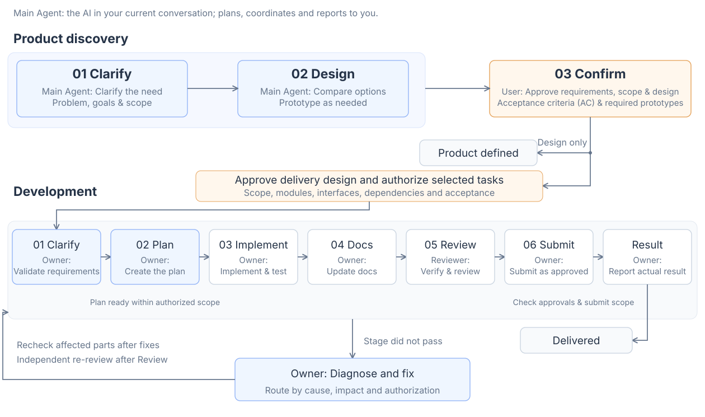
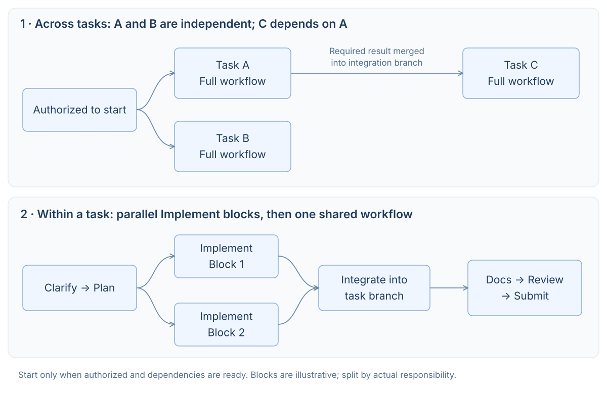

<p align="right">English | <a href="README.zh-CN.md">中文</a></p>

# TD Harness Build

Build or upgrade a project **Harness** with a **multi-agent workflow**, from requirements to implementation, verification and delivery.

## 1. Getting started

Install in the project directory:

```bash
npx skills@latest add YangZhaoWeblog/skills-develop --skill td-harness-build -y
```

**New project**

```text
$td-harness-build I want to build an Obsidian plugin.
```

**Existing project**

```text
$td-harness-build
```

After completion, review the diff and confirm that existing rules have been preserved.

## 2. Start developing

Tell the AI what you need. It will follow the project's **Workflow**.

- **Add a feature**: Export selected notes as Anki cards.
- **Fix a bug**: Images are missing from exported notes. Help me investigate and fix it.
- **Improve the experience**: The export settings are too complicated. Help me redesign them.

## 3. Workflow

1. **Product work** ends when the delivery requirements and acceptance criteria (AC) are confirmed. Development can start in another session.
2. **Development starts** after the delivery design is confirmed and the tasks allowed to start are explicitly authorized. You can authorize just one task.
3. **Each task** begins with development Clarify. Pause for an answer when a key decision requires the user. After clarification, refine the Plan and implement when it is ready within the authorized scope; individual Plans do not require another approval.
4. **Submission** follows successful verification and independent review, within the effective authorization. Check merge and release authorization separately.

[](assets/workflow-overview.en.svg)

<details>
<summary>Detailed rework diagram</summary>


</details>

### Parallel execution

Only authorized tasks with ready dependencies may start. The first layer shows task dependencies; the second expands one task's implementation.

<p align="center">
  <a href="assets/task-relationships.en.svg"></a>
</p>

Use one session to coordinate multiple tasks, or separate terminals for individual tasks. See [Agent responsibilities](assets/project/agent-roles.md#1-分工) for ownership and resource isolation.
