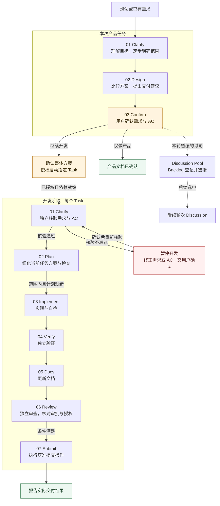

# {{PROJECT_NAME}} — AI 协作入口

**项目:** {{一句话项目用途}}；**Stack** 采用{{主要语言 / 框架}}

## 一、Index

入口只维护项目规则、稳定约束和跨任务导航；不列具体任务链接，不记录当前进度、审批结论或执行结果。

| 何时读取               | 主题                   | 文件                                                                   |
| ------------------ | -------------------- | -------------------------------------------------------------------- |
| 明确产品整体目标或安排后续需求时 | **PRD / Backlog** | `.harness/product/01-prd.md`、`.harness/product/02-backlog.md` |
| 承接暂缓事项的讨论时 | **Discussion Pool** | `.harness/product/03-discussion-pool.md`，只读相关条目 |
| 派发工作或处理返工时 | **Agent 分工** | `.harness/agent-roles.md` |
| 讨论产品 或 核验开发条件 时    | **需求澄清**             | `.harness/docs/clarify.md`                                           |
| 修改模块或调用链时          | **架构与模块**            | `.harness/docs/architecture.md`                                      |
| 修改服务交互时            | **上下游依赖**            | `.harness/docs/dependencies.md`                                      |
| 核对接口和字段时           | **接口契约**             | `.harness/docs/contracts/index.md`，再读其中的实际契约源码                            |
| 设计或修改接口时           | **API 规范**           | `.harness/docs/contracts/api-standards.md`                                |
| 修改数据库读写、事务、表结构或 Migration 时 | **数据库 / Schema**     | `.harness/docs/data/database.md`                                     |
| 设计用例或执行红绿循环时       | **Unit Test**        | `.harness/docs/testing/unit-tests.md`、`.harness/docs/testing/tdd.md` |
| 验证真实依赖协作时          | **Integration Test** | `.harness/docs/testing/integration-test.md`                 |
| 选择检查或处理失败时         | **验证规则**             | `.harness/docs/verification.md`                                      |
| 编写或修改代码时           | **编码与分层**            | `.harness/docs/coding-style.md`                                      |
| 新增日志或排查问题时         | **Logging**          | `.harness/docs/logging.md`                                           |
| 独立审查和人工验收时         | **Code Review**      | `.harness/docs/code-review.md`                                       |
| 准备环境、启动或调试时 | **本地开发** | `.harness/docs/devops/local-dev.md` |
| 执行发布或恢复时         | **发布与恢复**             | `.harness/docs/devops/release.md`                                 |
| 核对项目专用概念时          | **术语表**              | `.harness/docs/glossary.md`                                          |
| 排查已知问题或完成复盘时       | **失败记录**             | `.harness/docs/failures.md`                                          |

## 二、Workflow

### 2.1 进入流程

- **新需求**：从产品 Clarify 开始，在讨论中明确本次范围。
- **继续任务**：按 §2.5 定位 Overview 和当前阶段，读取本次记录与相关选型依据，继续未完成工作，不要求用户重述。
- **纯答疑**：直接回答，不创建任务。

主 Agent 是当前与用户对话的 Agent，负责规划、编排和汇报。产品 Confirm 须用户确认；继续开发时，先确认本次整体方案及允许启动的 Task。各 Task 在授权范围内完成 Plan 后连续执行。Review 后核对审批与提交授权，具体边界见 §2.6。



图中实线表示阶段推进，虚线表示暂缓内容的去向；资料存放见 §2.2.2，失败处理见 §2.3.4。

### 2.2 产品工作流

#### 2.2.1 阶段与产物

| #   | 步骤               | 产物                                                  | 说明                                                                                |
| --- | ---------------- | --------------------------------------------------- | --------------------------------------------------------------------------------- |
| 01  | **Clarify（澄清）**  | `01-discussion.md` | 明确本次问题、目标、范围与验收条件，先记入 Discussion，不填写正式需求和 AC |
| 02  | **Design（方案设计）** | `01-discussion.md` 及原型 | 比较方案，按需用原型消除疑问；要求、取舍和验收条件继续记入 Discussion |
| 03  | **Confirm（确认）**  | `02-delivery-requirements.md` §5、`03-acceptance-criteria.md` | 用户确认讨论结论后，统一生成需求与 AC，再交用户审阅确认；开发所需要求须完整写入                                                |

#### 2.2.2 范围确认与资料去向

用户确认哪些本轮做、哪些暂缓后：

- **本轮做**：讨论结论整理为本轮交付需求与 AC，交用户审阅确认。
- **本轮暂缓**：讨论细节迁入 Discussion Pool，Backlog 登记并链接；后续选中时承接到该轮 Discussion。
- **已确认的整体要求**：维护在 PRD，包括以后才开发的部分；Backlog 中的详细要求引用 PRD。

移出、承接或同步产品资料时，按 [clarify.md §2「资料维护」](.harness/docs/clarify.md#2-资料维护) 执行，不在这里重复定义清理与内外部同步规则。

已确认的技术选型及理由写入 [architecture.md §6](.harness/docs/architecture.md#6-技术选型与设计决策)，标明未实现项；产品 Overview 只留链接。

#### 2.2.3 产品阶段结束后

只做产品设计时，Confirm 完成即可结束。继续开发前，先确认工程和必要检查入口已就绪；有缺口时，按已批准范围补齐并验证入口；涉及初始化或升级时可使用 **td-harness-build**。日常任务从本项目规则与模板运行，无须安装构建 Skill。

### 2.3 开发工作流

#### 2.3.1 阶段与产物

| #   | 步骤                | 产物                | 说明                                                                                    |
| --- | ----------------- | ----------------- | ------------------------------------------------------------------------------------- |
| 01  | **Clarify（澄清）**   | `01-clarify.md`   | 核验需求与 AC 是否明确、可实现、可验证；确认任务范围和必要拆分                                                     |
| 02  | **Plan（计划）**      | `02-plan.md`      | 逐文件列改动、影响和契约；设计验收测试（Acceptance Test，AT）及其他检查，写明通过标准与回退；核对本 Task 启动授权，范围内计划就绪后实现                        |
| 03  | **Implement（实现）** | `03-implement.md` | 按计划逐行为红绿循环，持续执行低成本检查                                                                  |
| 04  | **Verify（检查）**    | `04-verify.md`    | 执行所选检查及 AT，记录失败和复验；按验证规则核对推进条件；检查选择、测试复用、环境准备与失败处理见 `.harness/docs/verification.md` |
| 05  | **Docs（文档更新）**    | `05-docs.md`      | 更新受影响的长期事实和契约历史；无变化说明不涉及                                                              |
| 06  | **Review（独立验收）**  | `06-review.md`    | 独立核对需求、规则和证据；修正复验、复盘后，满足项目审批并核对用户已批准的提交范围                                                 |
| 07  | **Submit（提交）**    | `07-submit.md`    | 按授权执行 commit、push 或 PR；合并和发布另行授权。提交策略、预登记与冻结见本阶段文件，报告实际结果                             |

#### 2.3.2 执行分工

主 Agent 负责 Clarify、Plan 和协调；独立 Coder 实现，Verifier 验证，Reviewer 审查，Executor 更新文档并执行获准提交。具体职责见 [agent-roles.md](.harness/agent-roles.md)。

每阶段按 §2.4.2 完成记录与检查，再继续下一阶段。

#### 2.3.3 并行执行

- **Task 之间**：独立任务可并行，各自走完整 Workflow；有依赖的任务等上游成果合入项目集成分支。
- **Task 内部**：只在 Implement 阶段并行，汇回任务分支后，统一执行 Verify → Docs → Review → Submit。

本次安排写入 **Plan**；分工、共享资源和交接规则见 [agent-roles.md §1](.harness/agent-roles.md#1-分工)。

#### 2.3.4 反馈与返工

1. **先查明问题**：阶段未通过或需要其他角色处理时，报告主 Agent；原因不明先调查，多个问题按依赖顺序处理。
2. **确定返回位置**：主 Agent 根据原因、影响和授权安排处理，常见情况见下表。
3. **修正后复验**：补做受影响的验证与文档更新，保留仍有效的结果；已经进入 Review 的，独立复审通过后再继续。

| 问题 | 返回位置 |
|---|---|
| 需求或 AC 有误 | 产品阶段修正并请用户确认，再回开发 **01 Clarify** 核验 |
| 方案或用例设计需调整 | **02 Plan** |
| 代码或测试实现有误 | **03 Implement** |
| 验证未完成或证据失效 | **04 Verify** |
| 文档有误或遗漏 | **05 Docs** |
| 提交操作失败 | **07 Submit**：先核对实际结果，再继续获准操作 |

范围内修复或执行顺序微调，记录后继续。改变实现范围、接口契约或架构时，先说明变化，更新产品 Overview 中的整体方案并取得变更批准，再修订受影响 Plan；需求或 AC 也变化时，先回产品 Confirm，再重做开发核验。其他确认条件见 §2.6。

派发与续接见 [agent-roles.md §2](.harness/agent-roles.md#2-派发与返工)；提交后的修正与冻结按当前任务 **07-submit.md** 执行。

### 2.4 文件与记录职责

#### 2.4.1 本次交付目录

一次确认的交付范围共用一套产品资料，可包含多个 **User Story**（用户想完成什么，为什么？）。每个 Story 关联 **AC**；按独立执行、验证和收尾的价值拆分开发 **Task**，不按前后端机械建任务：

```text
.harness/plans/YYYY-MM-DD_数据导出/  # 完整需求：用户创建导出任务，并下载生成的文件
├── product/
│   ├── 00-overview.md             # 来源与确认；任务拆分、AC 归属、依赖及任务链接
│   ├── 01-discussion.md           # 本次讨论依据与未决问题
│   ├── 02-delivery-requirements.md # 本次需求、Stories与方案
│   ├── 03-acceptance-criteria.md  # AC与Story关联、场景入口
│   └── acceptance.feature        # Gherkin 验收场景
└── development/
    ├── task-01_创建导出任务/
    │   ├── 00-overview.md         # 当前步骤、进度与决策
    │   └── 01…07 阶段文件         # 各阶段执行结果
    └── task-02_下载导出文件/       # 同样结构，独立记录进度
```

#### 2.4.2 阶段记录

每个阶段结束前，完成三件事：

1. 填写本阶段记录，核对完成检查。
2. 更新 Overview 的进度和实际时间；漏记时间如实注明。
3. 补齐缺项，再继续下一阶段。已获准连续执行时也保留这些记录。

提交后发生返工时，记录更新范围按 **07-submit.md** 的冻结规则执行。

### 2.5 创建与恢复

#### 2.5.1 定位与恢复

| 任务 | 定位依据 |
|---|---|
| 产品任务 | 用户指定的产品 Overview |
| 开发任务 | 当前分支与 Overview 的 Meta 匹配 |

**查找时只读 Meta**，排除模板目录；定位不明确时请用户确认。

若任务未结束，读取其 Overview、当前阶段文件及 Index 中的相关规则，按 §2.6 核对仍有效的启动授权，汇报进度并继续；
Submit 已预登记完成时，按 **07-submit.md §4** 核对实际 Git／平台状态及未完成返工；有返工先回对应阶段，只有提交操作未完成才续做 Submit，不因预登记而新建任务。
新需求按下方步骤创建；同一需求继续更新产品文档，原开发任务已结束时，后续开发另建任务。纯答疑不创建任务。
#### 2.5.2 读取边界

按当前问题读取相关章节，适用硬约束必须核对。下表是许可范围，不是必读清单；不递归追读全部链接，不重复读取未变化的内容。

**当前交付**指 .harness/plans/ 下一个直接子目录。链接和搜索不扩大权限；可读不等于可修改。

| 对象 | 可读内容 |
|---|---|
| 当前 Task | Overview、当前阶段、相关规则与必要依据 |
| 当前交付的产品资料 | 核对安排与启动授权时读 Overview §4；讨论时读 Overview、Discussion；正式文档生成后读交付需求、AC 与 acceptance.feature，Discussion 按具体问题补充 |
| 同交付的其他 Task | 仅 Overview、04-verify，用于依赖与完整 AC 证据 |
| 其他交付 | 不读任务正文，不沿链接跨入 |
| 项目公共文档 | 按 Index 和当前问题读取 |

**旧任务**保留原文件名与阶段记录，不套用新编号。**临时工作块分支**按原 Task 的分支／worktree 映射恢复，不新建 Task；无法定位时先核对原任务入口。

#### 2.5.3 模板保护

- **日常任务**：.harness/templates/ 与源 Skill 模板只读、可复制；任务内容写入 .harness/plans/ 下的副本。
- **授权维护**：用户明确批准后，只改指定模板与范围；临时授权不延续到其他任务。
- **临时变更结束**：按约定恢复，仅撤销本次临时差异，保留任务副本和无关修改。

#### 2.5.4 创建任务

1. **确定目录与分支**：开发 Task 从项目集成分支创建任务分支；有依赖时，等上游约定成果合入后再创建。一 Task 一任务分支，Implement 工作块按 Plan 在授权范围内使用临时分支和 worktree；保留历史任务和无关改动。
2. **复制完整模板**：开发任务复制 00–07 全套文件；目标已存在则恢复，不覆盖。
3. **填写副本**：保留章节、表格和完成检查。不适用项说明原因，后续阶段保持未开始；跨阶段只摘要并链接原记录。新增章节或改变记录职责须用户确认。
4. **清理填写说明**：删除顶部创建说明；将完整 WORKFLOW-GUIDANCE 规则块（含标记）替换为原模板文件引用，保留表格和任务记录。

以下命令适用于 **Bash／Zsh**。其他 Shell 使用等价操作，保持完整复制、目标已存在则恢复且不覆盖。

在项目根目录执行，替换目标路径；产品任务改用 **.harness/templates/product/**：

```bash
template_dir='.harness/templates/development'
task_dir='.harness/plans/YYYY-MM-DD_<title>/development/<task>'
mkdir -p "$(dirname "$task_dir")"
test ! -e "$task_dir" && test ! -L "$task_dir" && cp -R "$template_dir" "$task_dir"
```

技术正文放在外部时，仍在 **05-docs.md** 记录目标、改动与一致性核对。

### 2.6 用户确认

**产品确认**：用户确认本次需求与 AC。只做产品时到此结束。

**开发启动**：开发前向用户展示本次整体方案：范围、主要模块职责与接口变化、Task 划分和依赖、验收方式；需要时配架构图。整体方案和允许启动的 Task 分别确认，记录在产品 Overview §4。可只启动其中一个 Task，其他 Task 等后续授权；同一方案下不重复审批。

**Task 推进**：已获启动授权且依赖就绪的 Task，按实际代码和上游成果细化 Plan。完成检查后连续实现，不逐 Task 请求 Plan 批准；超出整体方案的范围、架构或公共接口变更，只确认变化部分。Review 独立执行，项目要求的人工审批仍须完成。

**按操作核对授权**：本地 commit、工作块合并、push、创建 PR、合入集成分支和发布分别核对，不相互推定。可随整体方案列明并取得授权，也可另行申请；Plan 引用有效授权；只批准实现不等于允许提交。

**范围内连续执行**：已有附条件授权，条件满足就继续；缺少授权或条件未满足则等待，不重复申请已有的有效批准。

遇到以下情况，说明依据、影响及建议，等待用户决定：

| 需确认的情况 | 提交的信息 |
|---|---|
| 方案需用户选择 | 选项、取舍和推荐理由 |
| 缺少关键决定 | 缺口、影响与待决定事项 |
| 需求或 AC 要修改 | 修改方案；确认后重新核验。外部原文仅在获准维护范围内更新 |
| 修正超出批准范围 | 变更与影响，包括历史模块、架构、数据结构；旧代码重构按 verification.md 核对 |
| 环境、真实数据或外部副作用未获授权 | 操作、影响与所需授权 |
| 必要验证无法完成，或独立核验有实质争议 | 缺口、依据和处理方案；是否需用户确认按 verification.md §3.3 核对 |
| 降低门槛或接受风险例外 | 原因与风险 |

---

## 三、开发准则

### Commands（项目命令）

**Module / Package**：{{模块或包名}}；**入口**：{{启动入口；库项目填写公开入口}}

| 用途        | 已有入口              |
| --------- | ----------------- |
| 构建 / 类型检查 | {{命令或规范章节链接}}     |
| 测试 / 质量检查 | {{测试、编码规范中的固定入口}} |
| 代码生成      | {{命令或不涉及}}        |
| 本地启动      | {{命令或不涉及}}        |

在开发工作流中，按任务范围执行这些入口。Git hooks 和 CI 的接入情况以实际配置为准；工具缺失明确标记。详细命令与参数在对应规范维护，本表作为索引。

### Structure（目录与分层）

| 路径         | 职责与边界                 |
| ---------- | --------------------- |
| {{入口目录}}   | {{启动与依赖装配}}           |
| {{核心模块目录}} | {{业务、数据访问等实际分层及依赖方向}} |
| {{生成目录}}   | {{生成源及允许的修改方式}}       |

只列开发时必须知道的目录。完整关系见 `.harness/docs/architecture.md`。

### Rules（项目硬约束）

从项目现有规范和实际代码填写高频约束；详细规则维护在对应专题文档。

| 约束      | 规则与依据                    |
| ------- | ------------------------ |
| 分层与依赖   | {{允许的调用方向、复用代码归属及依据}}    |
| 接口与数据变更 | {{契约先行、生成代码、迁移和兼容要求及依据}} |
| 编码与错误处理 | {{项目特有约定及规范入口}}          |
| 保护分支    | {{实际保护分支；禁止直接推送}}        |

开始实现前核对：工作分支有效、改动聚焦、Plan 与适用测试用例齐备、分层符合约定；记录一句话目标和硬阻塞，无则写“无硬阻塞”。

---

## 四、禁止红线

| #   | 红线                                                                     |
| --- | ---------------------------------------------------------------------- |
| 1   | **严禁越过§2.5读取白名单。** 仅按“2.5 创建与恢复”定位和调度；用户明确指定的参考内容只留对话上下文，禁止自动写回。     |
| 2   | **严禁未授权实现。** 未获本 Task 启动授权，或 Plan 尚未完成，不得写生产代码或启动写代码 Agent。              |
| 3   | **行为改动严禁先实现后补测试。** Plan 先列用例，Implement 按行为逐个 Red → Green；具体边界见 TDD 规范。 |
| 4   | **严禁编造执行证据和时间。** 未执行、失败、漏记必须如实记录。                                      |
| 5   | **严禁直推保护分支、使用裸 `--force` 或夹带无关改动。** 提交与合入按 Submit 授权及项目规则执行。           |
| 6 | **禁止将外部输入直接拼接进 SQL。** 使用参数化查询（Parameterized Queries）。 |
| 7 | **禁止硬编码凭据（Hardcoded Credentials）。** 包括密钥、Token 和密码。 |
| 8 | **必须校验外部输入（Input Validation）。** 输出按场景转义（Contextual Output Escaping）。 |
| 9 | **加密必须使用标准库（Standard Library）。** |
