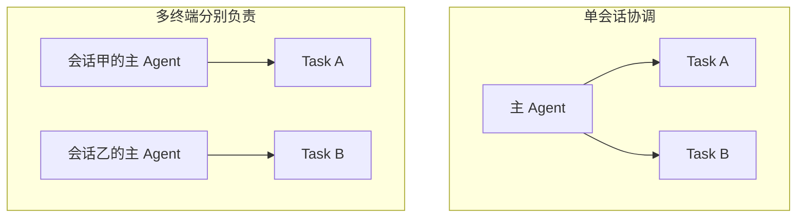

# Agent 职责与派发

主 Agent 派发、子 Agent 执行时读取。阶段与授权见 **AGENTS.md**，返工去向见其 **§2.3.4「反馈与返工」**；检查标准见 **.harness/docs/verification.md**。

## 1. 分工

### 1.1 角色职责

| 角色 | 模型档位 | 职责与交付 |
|---|---|---|
| **主 Agent** | 强模型 | 沿用当前用户会话，**无需另建**；负责 Clarify、Plan、任务状态、范围判断、编排及用户沟通 |
| **Coder** | 经济模型 | 在获准范围内按 Plan 实现与补测；报告改动、执行结果、偏差和阻塞 |
| **Verifier** | 强模型 | 执行核验：运行所选检查与验收操作，报告结果、证据及复验范围 |
| **Reviewer** | 强模型 | 独立语义审阅：核对需求、设计、代码、文档及验证充分性；按 **.harness/docs/code-review.md §1** 审阅并报告问题和结论 |
| **Executor** | 经济模型 | 更新指定文档、运行固定工具、执行获准 Submit；报告实际结果 |

**Executor 的文档依据**：使用阶段文件、日志、代码和工具输出等原始记录；主 Agent 摘要只作线索。写入前核对，无法核对的标“未核实”并报告。

使用项目已核实的模型；复杂任务或持续失败时，由主 Agent 调整拆分或模型。

### 1.2 主 Agent 与 Task

**每个 Task 同时只有一个主控。** 主控就是负责该 Task 状态与派发的主 Agent，不另设负责人角色。

支持一个会话协调多个 Task，也支持多个终端分别负责 Task：

每个 Task 按自己的 Workflow 派发上表角色；能否并行按 §1.3 的依赖规则判断。

**接手已有 Task**：先结束原主控对该 Task 的调度，再核对已有记录与实际成果。

### 1.3 Task 之间并行

已获启动授权的独立 Task 可以并行，各自走完整 Workflow。有上游依赖时，等成果真正合入项目集成分支，再从包含该成果的版本创建任务分支；**PR 已创建不等于已经合并**。

完整 AC 的验证责任按 **.harness/docs/clarify.md §3.3** 分配，具体安排记入产品 Overview。需要多个部分协作的用户操作，由指定 Task 在 Verify 中完成组合检查，不另建整轮验收阶段。

### 1.4 Task 内部并行

只在 **Implement** 阶段并行。Plan §1 写清每个工作块的职责、依赖、角色、负责文件，以及分支与 worktree 的对应关系。

所有工作块共用一套 **00–07** 记录。代码合并回任务分支后，统一执行 **Verify → Docs → Review → Submit**。

### 1.5 写入与共享资源

**文件写入**：同一实际文件只由一个写入者负责。同一逻辑文件在不同 worktree 中有重叠改动时，由主控安排汇合核对。

**共享资源**：数据库、端口和测试环境能低成本隔离则隔离；有干扰且无法隔离的操作顺序执行。接口含义、数据结构和公共行为先统一约定。

工作块频繁互相协调时，重新考虑是否合并工作块。

## 2. 派发与返工

每次派发给出 **目标、任务入口、必读依据、可改范围、授权和结束条件**。必读依据注明具体章节或条目及用途；不把主会话完整历史或全部 Harness 文档作为默认交接包。Agent 按 **AGENTS.md §2.5** 读取原文与实际变更，不只依赖主 Agent 摘要；交付结论与证据位置，不搬回全部过程。

**Coder、Verifier、Reviewer 使用独立上下文**；验证与审查不继承 Coder 完整对话。Verifier 不默认嵌套派发。

**写入边界**：Verifier 可写临时产物与验证记录，不改实现、测试断言、AC、Plan 或门槛；Reviewer 只读。

**完整委托**：非并行 Task 由一个 Coder 一次接收完整实施范围，在内部连续完成逐行为 Red → Green 和自检，交回可验收成果；不按测试、文件或红绿阶段逐次派发。并行时仅使用 Plan 预先确定的工作块，每块一个 Coder。

**集中返工**：主控汇总当前可取得的核验与审查意见，合并重复项和同类问题后，一次交回原 Coder 修正；不为单条意见或收件确认另起调用。

**三轮上限**：第一次把完整任务交给 Coder，算第 1 轮；之后把收齐的问题交回修正，最多再做两轮。即使一直使用同一会话，每次再发实施或修正指令也各算一轮。Coder 在一轮内自行编码、跑测试和完成红绿循环，不增加轮次；主控读取状态或等待也不计。轮次记在现有 Task Overview，换会话、模型或重新命名不重置。

**触顶停止**：第 3 轮交回后仍未通过核验或审查，停止自动续派，保留产物，向用户报告剩余问题、已知消耗和调整建议；不降低验收标准，也不自行增加工作块继续实现。

**返工续接**：正常返工续接原 Coder 会话；原会话无法可靠继续时才换。先用工具已有的恢复记录，无法定位时才在现有任务记录中补入口，不要求每轮填写 Session ID 或另建台账。

**提前止损**：同一失败反复出现且没有新依据时，在轮次用尽前停止当前修法；主控先查明原因，再在剩余轮次内调整方法。换会话也保留此前累计消耗。

缺少独立执行能力时报告缺口，不以主 Agent 自检代替。

<!-- PROJECT-CONTENT -->

## 3. 项目接入

每个平台、角色一行，维护最近一次核验的配置入口、日期和简短结论（通过／未核验／阻塞）；结论注明必要的适用范围或缺口，不逐轮追加历史。具体模型与推理设置以原生配置为准；过程证据写入对应任务记录，不在本文件展开。

| 平台 | 角色 | 配置位置 | 核验日期 | 核验结论 |
|---|---|---|---|---|
|  | Coder |  |  |  |
|  | Verifier |  |  |  |
|  | Reviewer |  |  |  |
|  | Executor |  |  |  |

摘要表示上次核验结果，不单独证明当前可用。平台、模型或权限变化，或证据不足时，复验受影响项。

Codex 子 Agent 继承主会话权限，角色配置不建立独立沙箱。核实实际模型、推理档位及权限。只能靠指令限制的写入边界须注明，由主 Agent 核对变更，不冒充沙箱隔离。
