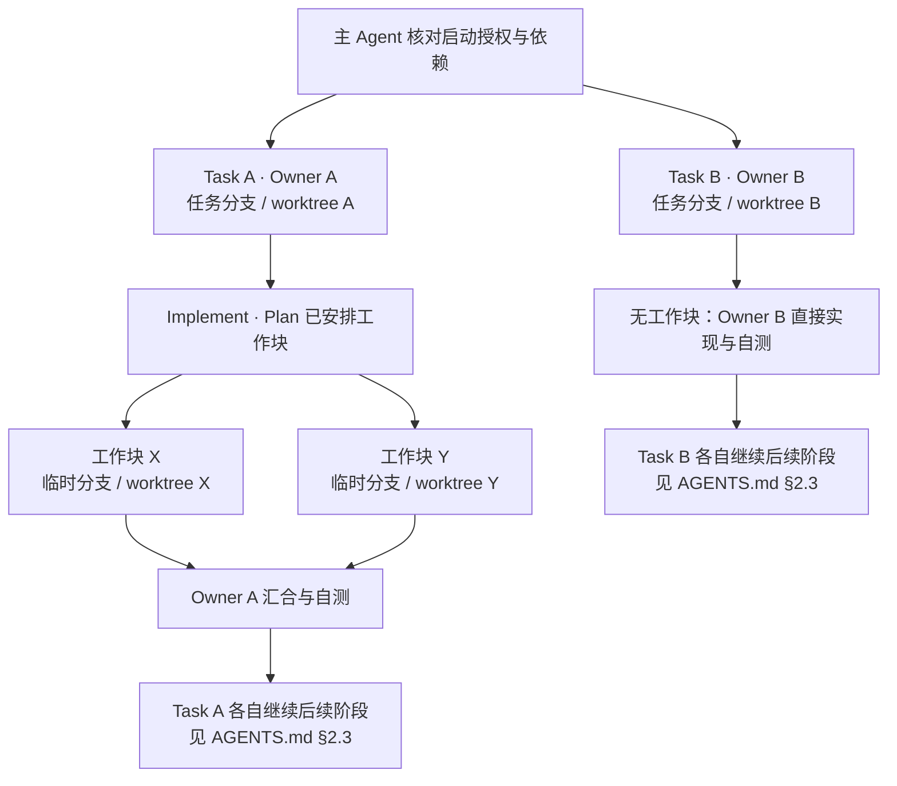

# Agent 职责与派发

## 1. 分工

### 1.1 角色职责

**每个 Task 一个 Owner，默认直接实现并负责交付；由一个未参与实现的 Reviewer 独立验证与审查。**

| 角色     | 职责                                                                          | 写入边界                                                               |
| -------- | ----------------------------------------------------------------------------- | ---------------------------------------------------------------------- |
| Owner    | 核验需求、制定 Plan、写代码与测试、执行检查、更新文档、修复问题及执行获准提交 | 本 Task 获准范围                                                       |
| Reviewer | 独立确认需求与实际结果，执行关键场景验证，审查差异及证据，一次集中报告问题    | 临时验证产物及本 Task 05-review.md；不改生产代码、正式测试、需求或门槛 |

### 1.2 主 Agent 与 Task

主 Agent 是当前与用户对话的 Agent。单 Task 时，主 Agent 就是 Owner。多 Task 时，主 Agent 协调多个 Task，日常与各 Task 的 Owner 对接，处理依赖、共享资源和集成。各 Owner 核验自己的 Task，主 Agent 汇总需用户决定的问题并合并重复项。

主 Agent 用各 Task 的 `00-overview.md` 看进度和依赖，收尾时按产品 `00-overview.md` §4 核对对应 `05-review.md` 的验收结果和版本。

### 1.3 Task 之间并行

产品 Overview 的任务表是依赖真源，列名为“前置依赖”。无依赖写“无”；有依赖写 Task ID 和必要的成果条件，例如“A：保存能力已合入集成分支”。依赖图仅辅助理解，不维护第二份状态。

上游成果合入后，主 Agent 按 AGENTS §2.6 核对下游 Task 能否推进。下游 Task 的分支和 worktree 从包含所需成果的集成版本创建。

### 1.4 Task 内部并行

Task 内部只在 Implement 阶段并行，按 Plan 预先明确工作块职责、写入范围和集成顺序。工作块汇回任务分支后，按项目 AGENTS.md §2.3 继续后续阶段；工作块共用一套 Task 记录。

主 Agent 和 Owner 可以位于同一会话或不同终端；每个 Task 的负责人及共享写入边界不随运行位置改变。

### 1.5 写入与共享资源

同一实际文件同时只有一个写入者。无逻辑依赖但存在共享写入冲突时，先隔离写入范围或协调集成次序，不把资源冲突伪装成产品依赖。

数据库、端口和测试环境等共享资源优先隔离；无法隔离且互相干扰的操作顺序执行。接口含义、数据结构和公共行为先统一约定；协调成本过高时重新考虑工作块划分。

## 2. 派发与返工

**写入边界**：按 §1.1 的角色表执行。Reviewer 使用独立上下文，实际验证当前版本；Owner 的完成总结不能替代独立验证。

**完整交接**：Owner 完成实现、自测和文档后，将目标、需求与 Plan 入口、待验版本、实际差异、必要证据及允许写入范围一次交给 Reviewer。注明必读章节及用途，不传整段历史；Reviewer 将实际验证与审查统一记入 05-review.md。

**集中返工**：Reviewer 一次报告当前可取得的、有依据的发现与验证缺口，同类问题归并，位置和处理分级按 [code-review.md §3](docs/code-review.md#3-审阅意见与处理)。Owner 在本 Task 范围内集中修复阻断项，原 Reviewer 更新原问题及复验结论。Reviewer 不派发子 Agent；实际验证与审查由本人完成。

**增量复审**：原 Reviewer 按 [验证规则 §3.4](docs/verification.md#34-修正与复验) 复验。新阻断照常报告，已有问题更新原记录。

**轮次与诊断**：首次独立验收算第 1 轮；Owner 将累计验收轮次记在 Task Overview，日常自测及红绿循环不计轮次，换 Agent、会话或模型不重置。第 3 轮仍未通过时，Owner 重新审视问题、证据及修法；三轮触发诊断，不自动停止任务或等待用户。

**进展判断**：只看原阻断是否有复验证据表明减少或解决，或新证据是否改变下一步做法。两者都没有，说明本次修复没有进展；代码改动、重复测试及完成声明本身不算进展。一次失败不自动暂停；重复已失败的方法且没有新证据时，先停止当前修法，核对前提、失败证据并取得能支持下一次尝试的依据。

**任务暂停**：必要条件无法自行补齐，或诊断后仍无法提出有证据支持的新尝试时，保留成果并报告剩余阻断、已尝试办法及恢复所需条件。暂停不算验收通过。改变范围、降低门槛、需求或 AC 有误及必要验证无法完成时，仍按 AGENTS.md §2.6 交用户决定。

**返工续接**：正常返工沿用原 Owner 与 Reviewer；上下文无法继续时，交接实际版本、差异和未解决问题。Task 恢复按 Overview 与实际产物定位，不重新定义范围或覆盖他人改动。

## 3. 项目接入

平台角色配置按本文件 §1 的分工接入，模型、档位和权限按实际平台及用户选择填写，不由模板猜测。

| 平台 | Reviewer 调用方式 | 模型 | effort | 配置文件 |
| ---- | ----------------- | ---- | ------ | -------- |
|      |                   |      |        |          |

平台配置仅绑定职责入口和实际模型、权限，不建立额外沙箱。Build 接入时使用 td-harness-build 的 agent-setup.md；项目日常任务使用本文件，不读取 Build 指导。
