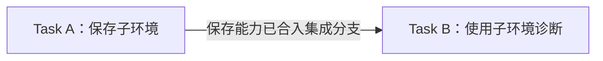

# [YYYY-MM-DD] <本轮需求标题>

> 本次交付的资料来源、产品确认与 Task（开发任务）关联；执行状态与证据由各 Task 维护。

<!-- 创建时读取 `git config user.name` 填负责人；读取不到时留空并请用户补充，不猜测。填写后删除本注释。 -->

## 1. Meta

- **摘要**：
- **产品阶段状态**：🟡 待开始 / 🔵 进行中 / 🟠 待确认 / ✅ 已确认 / ❌ 已取消
- **创建日期**：YYYY-MM-DD
- **负责人**：
- **预期完成**：

本字段概括本次产品阶段，依据 §2 的进度和用户决定填写：

| 状态   | 使用条件                                                         |
| ------ | ---------------------------------------------------------------- |
| 待开始 | 尚未开始本次产品讨论                                             |
| 进行中 | 正在澄清问题或比较方案                                           |
| 待确认 | 当前需求与 AC 等待用户确认；或变更影响原确认结论，尚未获用户同意 |
| 已确认 | 用户已确认当前需求与 AC                                          |
| 已取消 | 用户明确取消本次产品任务；暂缓或遇到阻塞不等于取消               |

本字段不维护开发整体完成状态；产品已确认不代表开发完成或已上线。同一交付范围的获批调整继续维护本次产品文档，历史记录保留。取消本轮时，按项目 **clarify.md §2.2** 处理仍需后续保留的讨论，再结束本轮。

## 2. 产品进度

| 阶段    | 状态      | 文件                                                                                                             |
| ------- | --------- | ---------------------------------------------------------------------------------------------------------------- |
| Clarify | ⏳ 进行中 | [Discussion：问题、目标与范围](01-discussion.md)                                                                 |
| Design  | ⬜ 未开始 | [Discussion：方案比较与原型](01-discussion.md)                                                                   |
| Confirm | ⬜ 未开始 | [需求确认入口](02-delivery-requirements.md) §5、[验收条件（Acceptance Criteria，AC）](03-acceptance-criteria.md) |

开始或完成一个阶段时，更新该阶段的状态和“上次更新”时间；完成后标记为 ✅ 已完成。用户确认当前需求与 AC 后，将 Confirm 标为 ✅ 已完成。需求或 AC 变化影响原确认结论且尚未获用户同意时，将 Confirm 改为待确认；已获批准的修改不重复询问。同步更新 §1 的产品阶段状态。

**上次更新**：YYYY-MM-DD HH:MM:SS

## 3. 需求来源

有外部需求、AC 或原型时，填写来源链接或讨论定位、相关条目与同步时间；没有则写“不涉及”。本次关键讨论见 [Discussion（讨论）](01-discussion.md)，获批需求以 [Delivery Requirements（交付需求）](02-delivery-requirements.md) 与 AC 为准。

原型结论与关键调整在讨论期间记入 **[Discussion](01-discussion.md)**；整理正式文档时归入 **[Delivery Requirements §3](02-delivery-requirements.md#3-design--prototype方案比较与原型)**。本页只维护原型入口与 §2 的确认状态。

| 资料          | 来源链接及相关章节 | 上次更新            |
| ------------- | ------------------ | ------------------- |
| 外部需求 / AC |                    | YYYY-MM-DD HH:MM:SS |
| 原型          |                    | YYYY-MM-DD HH:MM:SS |

同步来源内容后，填写“上次更新”；该时间表示本次同步时间。

## 4. 开发任务清单

继续开发时，先按项目 **clarify.md §3.3** 调查并填写本节，再确认整体方案和 Task 启动范围；随后创建获准且依赖就绪的开发 Task。只做产品时写“暂不开发”。后续安排按实际成果更新，进度见各 Task Overview，已结束记录保留。

**表格记录安排，Task 的 Overview 记录进度。** “关联 AC”说明本 Task 参与实现什么；“本 Task 完整验证的 AC”说明由谁确认整条验收条件达成。分工规则见项目 **clarify.md §3.3**。

**例：保存子环境，再使用它诊断。** 下表和图仅说明填法，使用时替换为本次真实安排，已创建的 Task 名称链接其 Overview，尚未启动的只列名称与依赖。关联项使用稳定编号与条目链接，共同约束可直接关联。

- **AC-01**：保存子环境后，重开仍能读取一致的配置。
- **AC-02**：用户保存子环境后，能够使用该配置完成诊断。

| Task 与 Overview 入口 | 本 Task 交付什么       | Story / AC 关联 | 前置依赖                   | 本 Task 完整验证的 AC |
| --------------------- | ---------------------- | --------------- | -------------------------- | --------------------- |
| A：保存子环境         | 配置保存与重开读取     | AC-01、AC-02    | 无                         | AC-01                 |
| B：使用子环境诊断     | 诊断实际使用保存的配置 | AC-02           | A 的保存能力已合入集成分支 | AC-02                 |

A 在自己的 Plan／Review 中检查保存与重开；B 除检查诊断功能，还实际验证“保存 → 使用配置诊断”。A 的局部结果不代表 AC-02 已通过。

前置依赖无则写“无”，有则写 Task ID 和必要的成果条件。协调者启动已获准且依赖满足的任务；上游成果集成后立即重新检查可启动任务。共享文件冲突按 agent-roles.md 协调，不编造逻辑依赖。

### 4.1 任务依赖图

多个 Task 时，用图展示表中的前置关系；独立 Task 不连依赖线，只有一个 Task 时可省略。**以表为准生成图**，任务或依赖变化时同步更新。

使用本地 AC 编号定位场景或补充条件；来源定位见对应场景的注释或补充条件旁的说明。本表和图不记录 Task 执行结果。检查交付情况时，按 AGENTS 读取边界核对关联 Task 的 Overview 与 Review 证据，不以任务数量代替 AC 达成。

### 4.2 整体方案与启动授权

按 **AGENTS §2.6** 给用户审阅以下摘要；详细设计已有记录时链接原文。

- **范围与预期结果**：引用本次交付需求。
- **主要模块、职责与接口变化**：说明关键取舍，需要时配架构图。
- **任务与验收安排**：引用本节清单和依赖图，说明如何验证完整结果。
- **整体方案确认**：用户决定、确认范围与依据。
- **允许启动的 Task**：列明已授权与暂不启动的 Task；后续授权在此更新。

整体方案确认不代表全部 Task 获准开工。Task 详细 Plan 随实际成果逐个完善；方案变更仅记录并确认变化部分。

## 5. 时间记录

开始和结束阶段时，读取系统时间并记录；漏记则留空，在备注中说明。耗时按起止时间计算，包含中途等待；返工时在备注中追加记录，不覆盖原时间，同一段时间不重复累计。

| #   | 步骤    | 开始时间 | 结束时间 | 耗时 | 备注 |
| --- | ------- | -------- | -------- | ---- | ---- |
| 01  | Clarify |          |          |      |      |
| 02  | Design  |          |          |      |      |
| 03  | Confirm |          |          |      |      |

## 6. 关键决策与风险

<!-- 按需记录影响后续工作的决定、风险与处理；已在需求或 AC 中记录的内容只链接，不重复。无则写“不涉及”。 -->

-
